# Lesson 6: Watching the Batcave (Process Management)

Part of the [Batcomputer Linux Lab](../README.md) | Previous: [Lesson 5](lesson-05-clearance-levels.md)

This lesson was about processes: seeing what's running, controlling it, and then turning my Lesson 4 threat report into a managed service that runs on a schedule under a locked-down service account. It builds on Lesson 4 (the `threat-report.sh` script) and Lesson 5 (permissions, ACLs, and the `batsvc` account).

## Environment
- **Host:** Ubuntu PC running VMware Workstation
- **Guest:** Ubuntu Server VM (`batcomputer`, 2 CPU cores), admin account `penny1`
- **Client:** SSH from my MacBook and from the host PC

## What I Built

### Seeing what's running
A **process** is a running program with a **PID**, a parent (**PPID**), an owner, and a state. I used `ps aux` and `ps -ef` for snapshots, `pstree` for the parent-child tree, and `htop` for a live view.

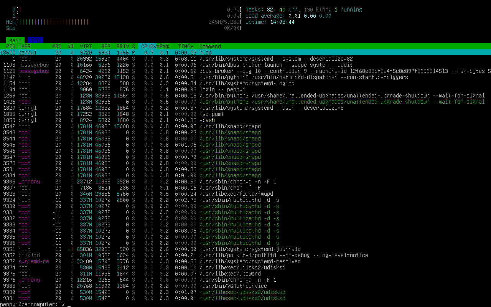

`htop` shows 2 CPUs, a load average of 0.01, and about 32 tasks. System daemons like `systemd`, `chronyd`, `cron`, and `snapd` are all just processes. Even system daemons use priorities: `systemd-journald` runs at nice value -1.


`pstree` shows everything hanging off `systemd` (PID 1). My own shell appears as `login(1194)---bash(1859)`, which is my console login, and the `pstree` command I ran is a child of that shell. Every process traces back to PID 1.

### Background jobs
`&` starts a command in the background, `jobs` lists them, `Ctrl+Z` pauses the foreground job, and `bg` and `fg` resume it in the background or foreground. I started two `sleep` jobs, paused one, resumed it, and checked their states with `ps` (`S` means sleeping).


These jobs belong to my terminal session, so they die if the connection drops. Anything that has to survive needs a service, which is where this lesson goes next.

### Signals
A **signal** is a message sent to a process.

| Signal | Number | What it does |
|---|---|---|
| `SIGTERM` | 15 | Asks the process to shut down, so it can clean up first (the default for `kill`) |
| `SIGKILL` | 9 | The kernel ends it immediately, and it cannot be caught |
| `SIGSTOP` | 19 | Pauses it |
| `SIGCONT` | 18 | Resumes it |

I paused a `sleep` process with `SIGSTOP` (state `T`), resumed it with `SIGCONT` (back to `S`), then ended it with a plain `kill`. I used a variable (`SLP=$!`) for the PID so I wasn't copying numbers by hand.


To see why `SIGTERM` comes first, I wrote a small script with a `trap` that prints a message and exits cleanly. Sending it `kill -15` made it print `Caught SIGTERM, cleaning up...`, so it got the chance to clean up. `SIGKILL` can't be caught, so a program killed that way gets no chance to tidy up.


### Priority
The **nice value** (-20 to 19) tells the scheduler who gets CPU first. I pinned two CPU hogs (`yes > /dev/null`) to one core with `taskset`, started one with `nice -n 19`, then used `renice` to bring the other down to match. Here are both at nice 19, each taking about 49.9% of the shared core:

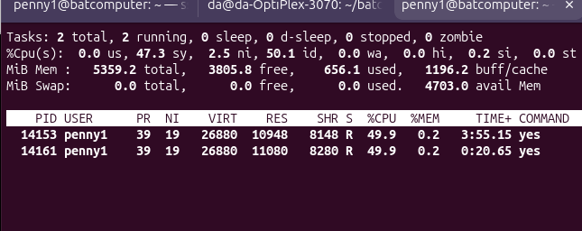

Regular users can only make their own processes *nicer*. Only root can raise a priority.

### Services with `systemctl` and `journalctl`
A **service** is a process that `systemd` starts, watches, and restarts for me. I checked the SSH service:

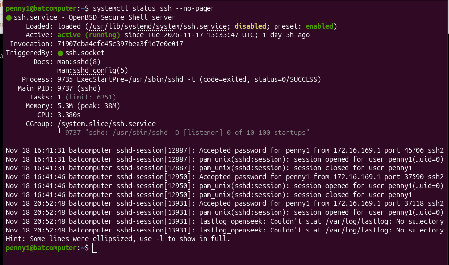

I restarted `cron` and watched its PID change from 14300 to 14347 while it stayed `active`:

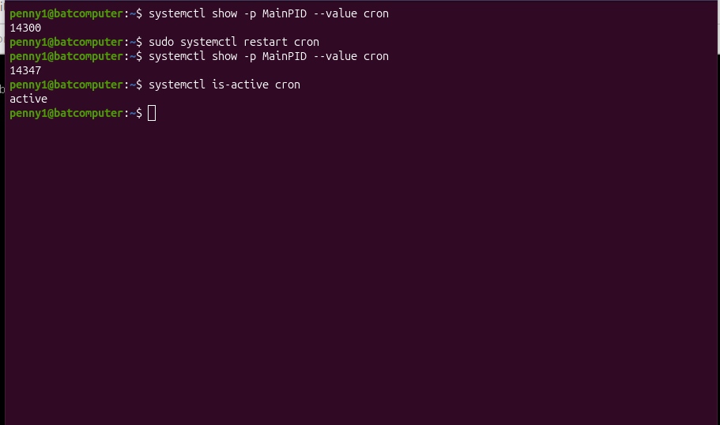

`journalctl -u ssh` shows the SSH service's own log, including the day I stopped it. The `Received signal 15; terminating` line is `SIGTERM` in real use: systemd asks the service to stop, the same way I did with my trap script.

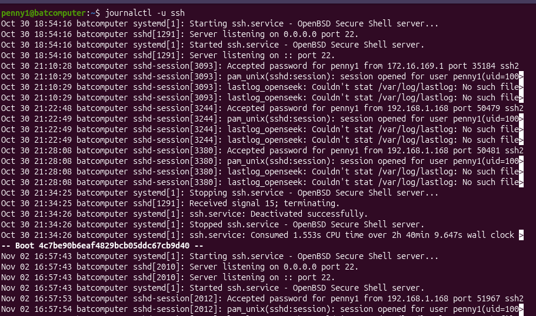

### A service for the threat report
I wanted `threat-report.sh` to run as `batsvc`, my service account, instead of as me. After Lesson 5's lock-down, `batsvc` can't reach the script. I'll cover why that confused me in the Issues section. The fix was ACLs that give it only what it needs: pass through `/opt/batcave` and `computer/`, and read and run that one script. It's not in `batfamily`, so it doesn't get access to the case files.

```bash
sudo setfacl -m u:batsvc:x  /opt/batcave
sudo setfacl -m u:batsvc:rx /opt/batcave/computer
sudo setfacl -m u:batsvc:rx /opt/batcave/computer/threat-report.sh
```

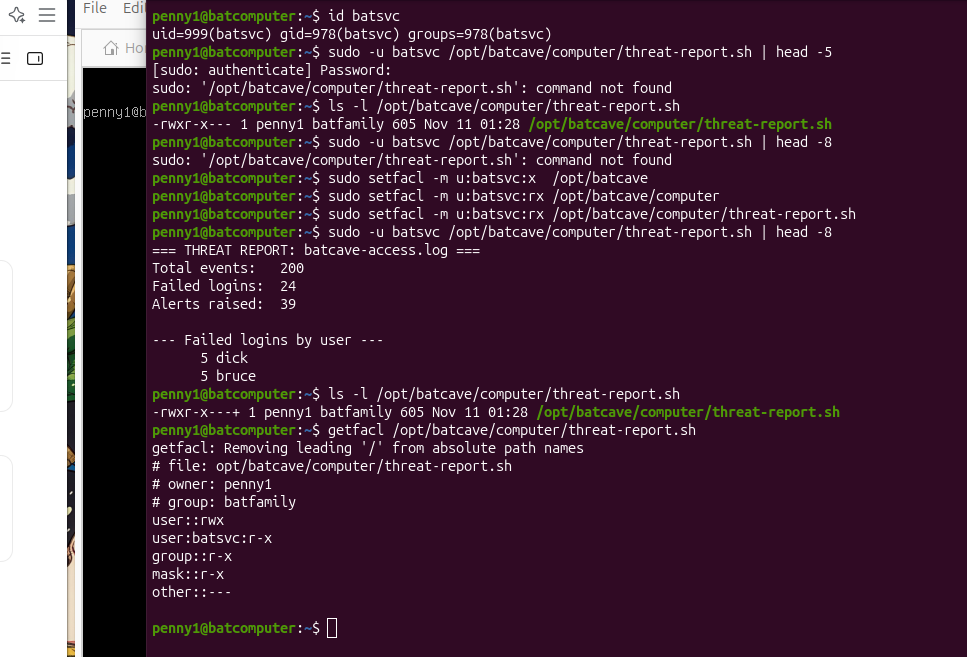

Then I wrote a service unit. It's a `oneshot` service, so it runs once and exits, as `batsvc`:

```ini
[Unit]
Description=Batcomputer threat report

[Service]
Type=oneshot
User=batsvc
ExecStart=/opt/batcave/computer/threat-report.sh
NoNewPrivileges=yes
PrivateTmp=yes
PrivateDevices=yes
PrivateNetwork=yes
ProtectSystem=strict
ProtectHome=yes
ProtectKernelTunables=yes
ProtectKernelModules=yes
ProtectKernelLogs=yes
ProtectControlGroups=yes
ProtectClock=yes
ProtectHostname=yes
RestrictNamespaces=yes
RestrictRealtime=yes
RestrictSUIDSGID=yes
RestrictAddressFamilies=AF_UNIX
LockPersonality=yes
MemoryDenyWriteExecute=yes
CapabilityBoundingSet=
SystemCallFilter=@system-service
UMask=0077
```

The full file is in [`config/systemd/batcave-threat-report.service`](../config/systemd/batcave-threat-report.service). The service's output goes to the journal:

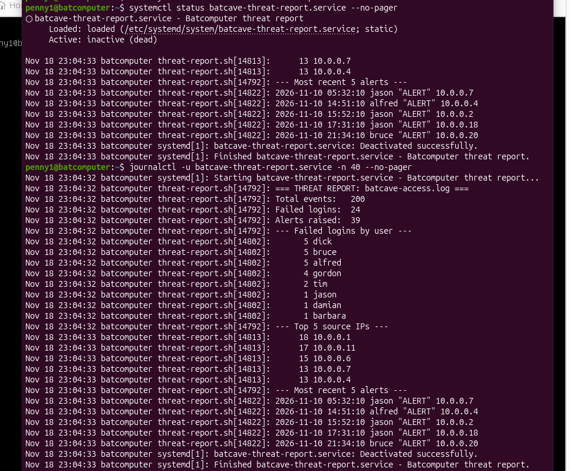

### Hardening it
`systemd-analyze security` scores a service from 0 (locked down) to 10 (wide open). My first version, with only four restrictions, scored **8.3 EXPOSED**:

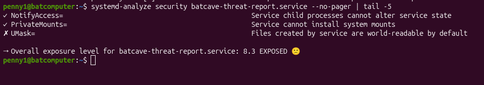

The script only reads a log and prints a report, so it doesn't need a network, kernel access, other users' files, or the ability to write anywhere. I added restrictions for each of those. The score dropped to **1.1 OK**, and the service still ran successfully:

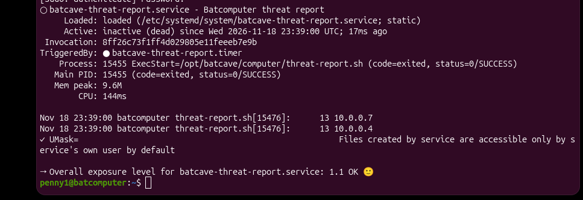

### Running it automatically
A **timer** is a second unit that starts a service on a schedule. I made one that runs the report every two minutes ([`config/systemd/batcave-threat-report.timer`](../config/systemd/batcave-threat-report.timer)):

```ini
[Timer]
OnCalendar=*:0/2
AccuracySec=1s
Unit=batcave-threat-report.service
```

`list-timers` shows when it will run next and when it last ran:

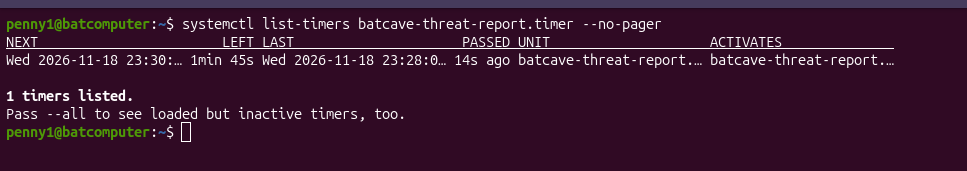

The journal shows the service starting by itself at 23:24, 23:26, and 23:28, two minutes apart, with no one running it:

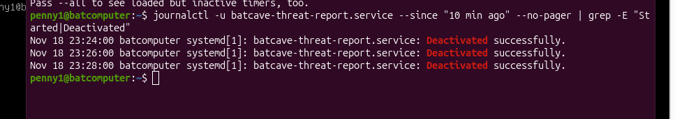

For comparison, I did the same kind of job with cron: a one-line crontab entry that appends the date to a file every minute. Then I removed it so nothing keeps running.

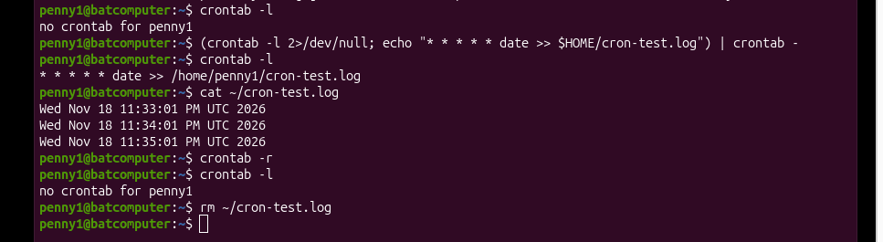

| | systemd timer | cron |
|---|---|---|
| Logs | In the journal (`journalctl -u`) | Separate, less integrated |
| Visibility | `systemctl list-timers` | `crontab -l` |
| Missed runs | Can catch up (`Persistent=true`) | Skipped |
| Simplicity | Two files | One line |

## Issues I Ran Into

### 1. I typed a placeholder literally
My instructions said `kill -STOP <PID of sleep 700>`, and I typed it exactly, brackets included. Bash treats `<` and `>` as redirection, so it gave `syntax error near unexpected token 'newline'`. Nothing was sent to any process. After that I used variables like `SLP=$!` instead of copying numbers.

### 2. I froze my own shell
After that error I picked a PID from earlier in my terminal and ran `kill -STOP 1859`. 1859 was the PID of **my own shell**, so I paused my own terminal. Nothing I typed worked, and the keystrokes just echoed on screen.

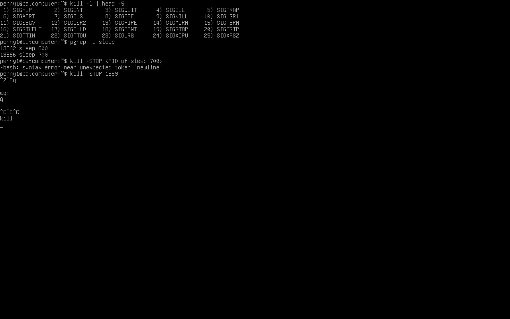

I opened a second session, confirmed the shell showed state `T`, and ran `kill -CONT 1859` to wake it up. The earlier `pstree` shows 1859 was the `bash` under my console login.

**Takeaway:** check what a PID is before signaling it (`ps -p <PID>`). On a real server, stopping the wrong process, like `sshd` over a remote connection, can lock me out.

### 3. `sudo` said `command not found` for a file that existed
When I first ran the script as `batsvc` (`sudo -u batsvc /opt/batcave/computer/threat-report.sh`), I got `command not found`, even though `ls -l` showed the file right there. The reason is that `batsvc` couldn't traverse `/opt/batcave` after Lesson 5, so from its point of view the path didn't exist. After the ACL lines, the same command printed the report, and `getfacl` showed the `user:batsvc:r-x` entry.

**Takeaway:** the error message doesn't always match the cause. When `sudo -u` says `command not found` for something I can see, the user probably can't reach the path.

### 4. The first service was still "EXPOSED"
A service that works isn't necessarily a safe one. My first version scored 8.3 EXPOSED. Adding restrictions until the service couldn't do more than it needs brought it to 1.1 OK.

## What I Noticed
- **`ssh.service` shows `disabled` but is running.** The status line `TriggeredBy: ssh.socket` explains it: a socket unit listens on port 22 and starts the service on demand. "Enabled" doesn't tell the whole story.
- **My SSH logins are password logins** (`Accepted password for penny1`), not key-based. That's something to tighten later, as part of hardening SSH.

## Key Takeaways
- Look before acting: `ps`, `pstree`, and `htop` show the state without changing anything.
- Try `SIGTERM` before `SIGKILL`, so the program can clean up.
- Verify a PID before signaling it, and use variables instead of typing numbers.
- Run services as a dedicated account with the narrowest access that works.
- A working service still needs hardening, and `systemd-analyze security` gives a score to improve.
- A timer plus a service is the standard way to schedule work on a modern Linux system, and cron is still worth knowing.

## Skills Demonstrated
- Viewing and tracing processes: `ps`, `pstree`, `top`, `htop`, `pgrep`
- Job control: `&`, `jobs`, `fg`, `bg`, `Ctrl+Z`
- Signals: `kill` (`SIGTERM`, `SIGKILL`, `SIGSTOP`, `SIGCONT`) and `trap`
- Process priority: `nice`, `renice`, `taskset`
- Service management: `systemctl`, `journalctl`, and writing systemd unit files
- Least-privilege service accounts with ACLs
- Service hardening and security scoring: `systemd-analyze security`
- Scheduling with systemd timers and cron
- Debugging from error messages

## Checklist
- [x] Viewed processes with `ps`, `pstree`, and `htop`
- [x] Ran background jobs, and paused and resumed them
- [x] Used signals, and saw `SIGTERM` caught by a script
- [x] Changed priority with `nice` and `renice`
- [x] Inspected services with `systemctl` and `journalctl`, and restarted `cron`
- [x] Built a service that runs the threat report as `batsvc` with a narrow ACL
- [x] Hardened it from 8.3 EXPOSED to 1.1 OK
- [x] Scheduled it with a systemd timer and compared it to cron

[← Lesson 5](lesson-05-clearance-levels.md)
