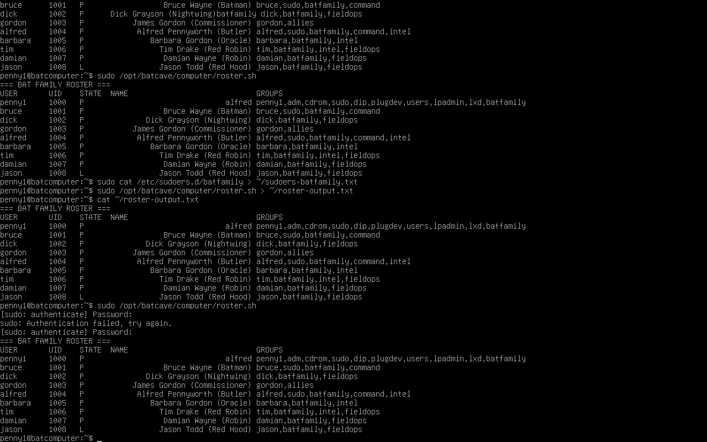
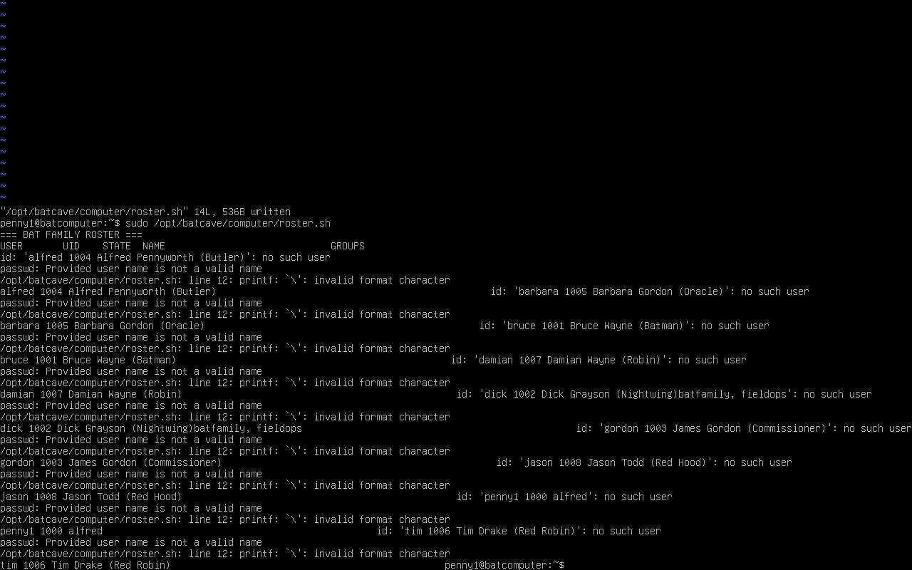
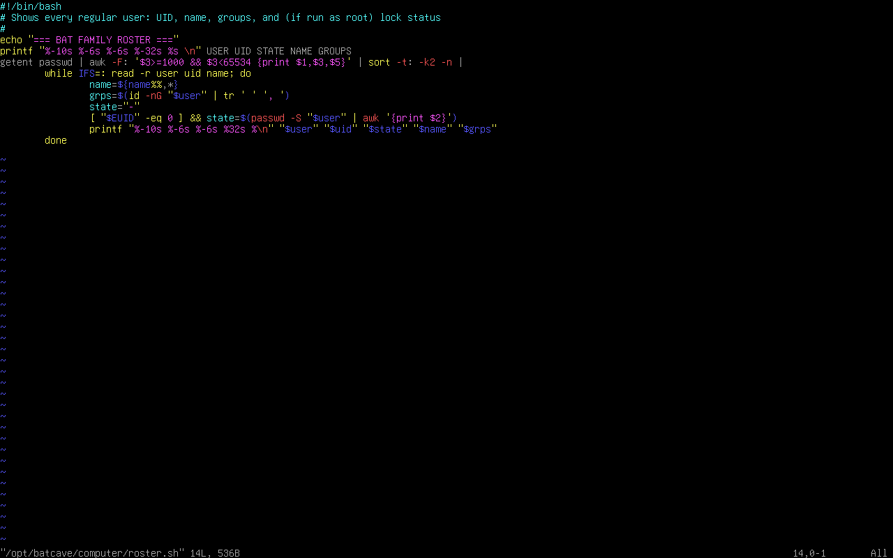

# Lesson 3: The Bat Family Roster (Users and Groups)

Part of the [Batcomputer Linux Lab](../README.md) | Previous: [Lesson 2](lesson-02-batcave-filesystem.md)

This lesson was about how Linux handles people. I created the whole Bat Family as real users and groups, set up sudo rules and password policy, and switched my Mac over to SSH key login. It's also the lesson where a couple of one-character typos taught me the most.

## Environment
- **Host:** Ubuntu PC running VMware Workstation
- **Guest:** Ubuntu Server VM (`batcomputer`), admin account `penny1`
- **Client:** MacBook, connecting over SSH through the VMware port forward

## What I Built

### The roster
| User | Role | Groups |
|------|------|--------|
| `penny1` | Sysadmin (already existed) | batfamily, sudo |
| `bruce` | Bruce Wayne (Batman) | batfamily, command, sudo |
| `alfred` | Alfred Pennyworth (Butler) | batfamily, command, intel, sudo |
| `dick` | Dick Grayson (Nightwing) | batfamily, fieldops |
| `barbara` | Barbara Gordon (Oracle) | batfamily, intel |
| `tim` | Tim Drake (Red Robin) | batfamily, intel, fieldops |
| `damian` | Damian Wayne (Robin) | batfamily, fieldops |
| `jason` | Jason Todd (Red Hood) | batfamily, fieldops, **locked** |
| `gordon` | James Gordon (Commissioner) | allies, **expires in 30 days** |
| `batsvc` | Service account | system user, no login shell |

Only `penny1`, `bruce`, and `alfred` get full sudo. That's least privilege: nobody gets more access than their role needs.

### How I built it

**A re-runnable script.** [`03-create-users.sh`](../scripts/03-create-users.sh) creates the groups, then the users, and skips anyone who already exists. Running it a second time proves it's safe to re-run: every user gets skipped.


**Passwords and policy.** I set passwords interactively so they never land in my shell history, and used `chage` to set Gordon's 30-day account expiry. The output shows both the account expiry date and a 30-day maximum password age.


**A locked account.** I locked Jason with `usermod -L jason`, then checked with `passwd -S`. The `L` in the second column means locked. The screenshot also shows the groups and their members.


**A roster script.** [`roster.sh`](../scripts/roster.sh) prints every real user with their UID, lock status, full name, and groups. The top rows in this screenshot are from an earlier run, before I fixed Dick's name. The later output is the corrected version.


## Issues I Ran Into

### 1. The groups didn't exist yet
When I ran the create-users script, it complained that `command`, `intel`, and `fieldops` didn't exist. `useradd -G` can't put someone in a group that hasn't been created, so the users that needed those groups failed.

**Fix:** I created the groups by hand, checked them with `getent group`, then reran the script. Because it's safe to re-run, it skipped the users that already existed and created the rest.

**Takeaway:** Create groups before the users that need them, and verify with `getent` before moving on.

### 2. The password "loop"
I used a `for` loop to set a password for every user, and it looked like it was stuck in an endless password prompt. It wasn't. The loop runs `passwd` once per user, and each one asks twice (new password, then retype it). Nothing shows on screen while you type a password, not even stars, which made it feel frozen.

**Fix:** `Ctrl+C` to get out. Then I checked who had a password with `sudo passwd -S <user>` (`P` means set, `L` means locked) and set the remaining ones one at a time.

**Takeaway:** A loop around an interactive command is hard to control. Doing them one at a time is slower but easier to follow.

### 3. The roster script: three errors, two typos
The roster script was the hardest part of the lesson. I typed it into vim by hand, and it threw a chain of errors. I fixed them in order by reading what each message said.




**Error 1: awk "unterminated string."** The line that builds the user list used `":"` inside the awk command, and the quotes didn't close properly. I rewrote it using `-v OFS=:`, which puts the colons between fields without any inner quotes.

**Error 2: `id: '...': no such user`.** The script was reading an entire line, like `alfred 1004 Alfred Pennyworth (Butler)`, as if it were one username. The loop splits lines on colons (`IFS=:`), but my awk line was printing spaces between the fields, because I'd left out `-v OFS=:`. With no colons, nothing got split.

**Error 3: `printf: '\': invalid format character`.** At the end of the last line I had typed `%\n` instead of `%s\n`. The `%` needs a letter after it to say what kind of value goes there, so printf choked on the `\`.



**Fix:** I edited lines 6, 9, and 12 in vim to add `-v OFS=:`, correct the `tr` command, and add the missing `s`. Then I checked the file with `bash -n`, which tests the syntax without running anything, and ran it again. The output came out clean.

**Takeaways:**
- Error messages point straight at the cause if I read them slowly. "No such user" with a whole line inside the quotes meant the splitting was broken. "Invalid format character" meant a typo in the format string.
- `bash -n script.sh` finds syntax errors before I run anything.
- I can test the first half of a pipeline on its own, before adding the rest, to see exactly what it produces.
- One missing character (`s`, or `-v OFS=:`) can break an entire script.

### 4. Dick's name had his groups stuck on the end
In the first roster output, Dick's name read `Dick Grayson (Nightwing)batfamily, fieldops`. His group list had been added to his name field, so his entry in the roster script was missing a separator between the name and the groups.

**Fix:** I corrected the entry in the script, then repaired the account:
```bash
sudo usermod -c "Dick Grayson (Nightwing)" dick
sudo usermod -aG batfamily,fieldops dick
```

**Takeaway:** Always run `id <user>` and `getent passwd <user>` after creating accounts. A script can finish without errors and still create bad data.

## Key Takeaways
- **Always `usermod -aG`, never `-G` alone.** Without the `-a`, it replaces a user's groups instead of adding to them.
- **Make scripts idempotent.** Checking whether something exists first means I can re-run a script safely.
- **Verify every step.** `getent`, `id`, `passwd -S`, and `bash -n` catch problems early.
- **Small typos cause confusing errors.** The error message usually points at the exact problem if I read it carefully.

## What I Left Out of the Repo on Purpose
No passwords, no copy of `/etc/shadow`, and no SSH private key. Only the scripts, the sudoers rule, and the roster output are published.

## Skills Demonstrated
- Creating and managing Linux users and groups (`useradd`, `groupadd`, `usermod`, `passwd`, `chage`)
- Least-privilege access with scoped sudo rules
- Account lifecycle: locking, expiring, and password aging
- SSH key authentication through a NAT port forward
- Bash scripting: loops, `awk`, `printf`, and idempotent design
- Debugging scripts from error messages and `bash -n`

## Checklist
- [x] Created the Bat Family users, groups, and a service account
- [x] Script runs twice with no errors or duplicates
- [x] Only `penny1`, `bruce`, and `alfred` have full sudo, plus a scoped rule for `intel`
- [x] Locked Jason and set Gordon's account expiry
- [x] Logged in over SSH with a key
- [x] Wrote and ran `roster.sh`

[← Lesson 2](lesson-02-batcave-filesystem.md) | [Lesson 4 →](lesson-04-case-files.md)
