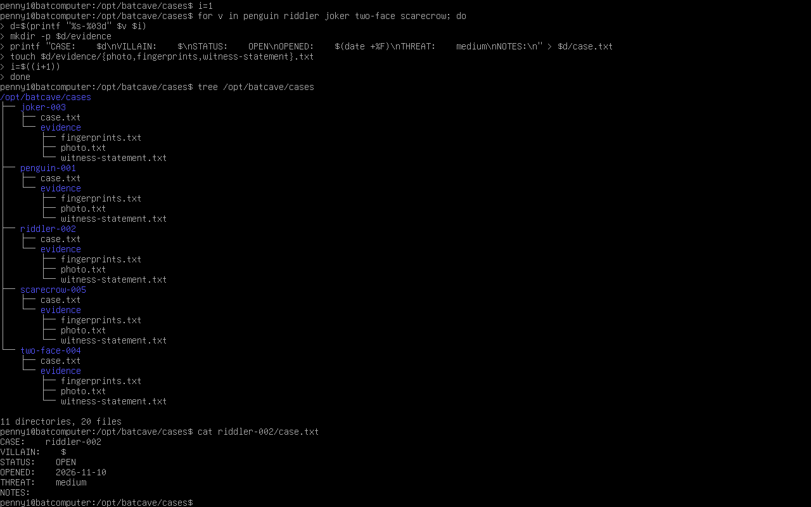
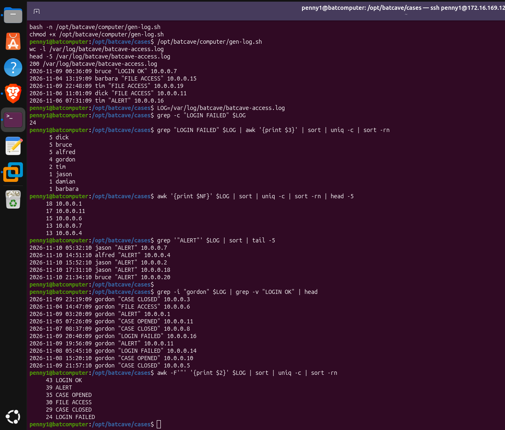
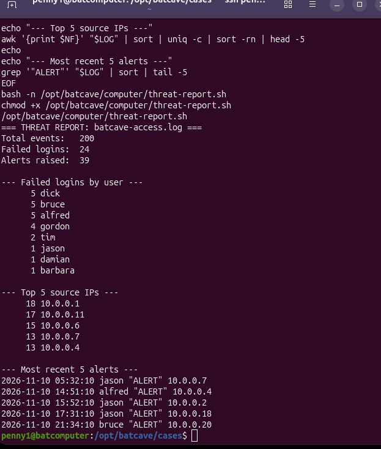
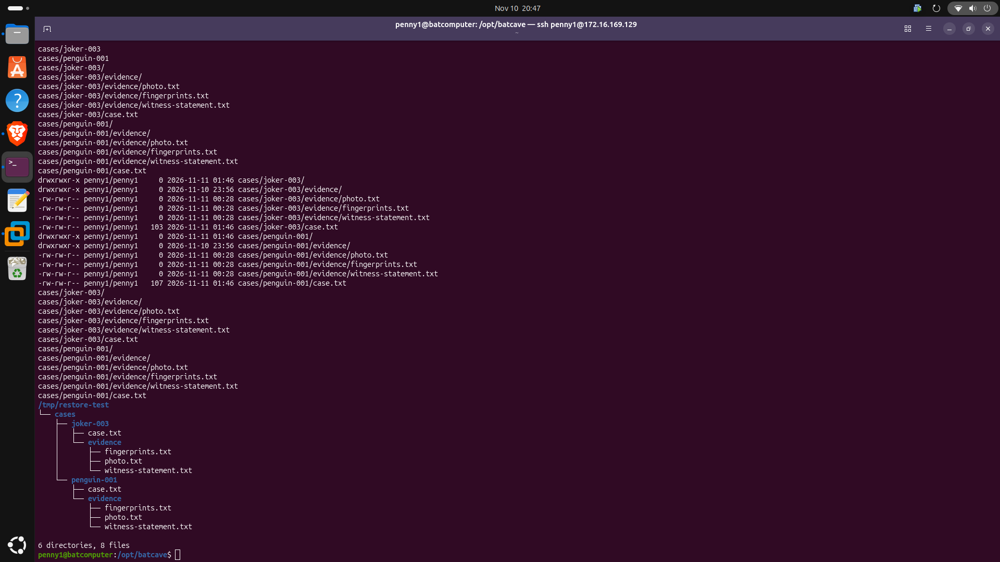
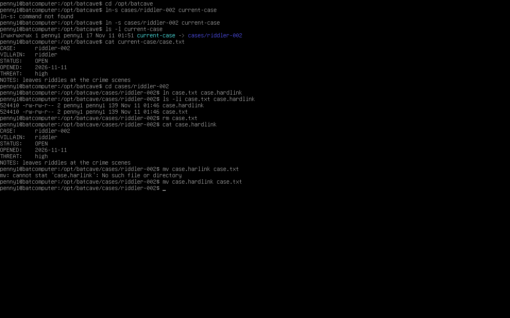
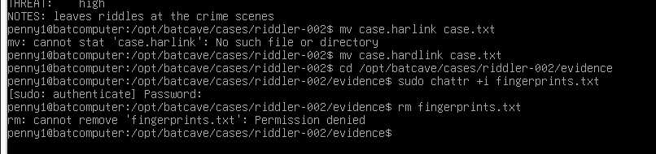
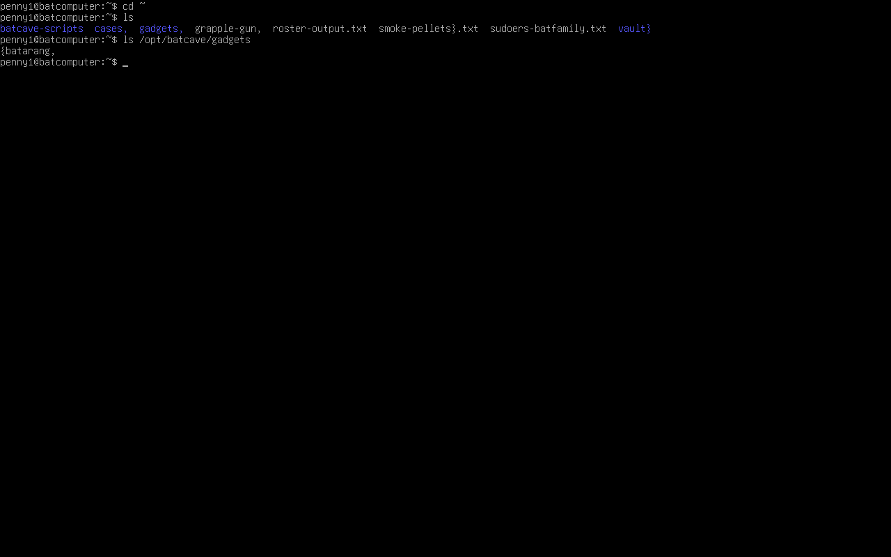
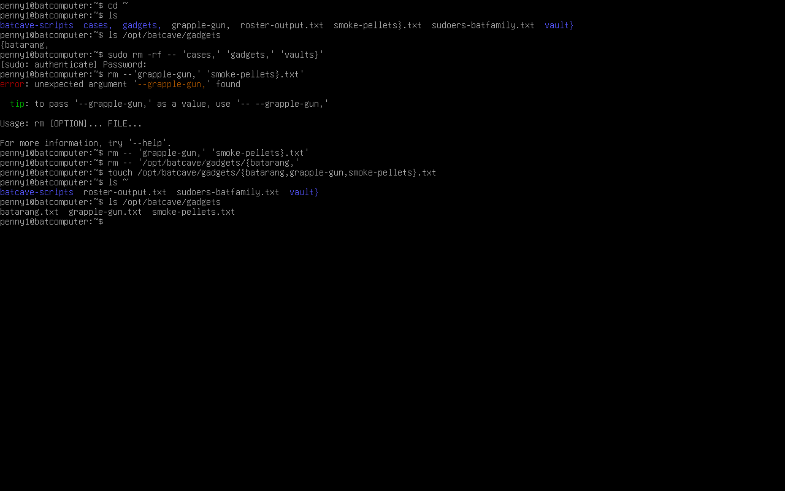
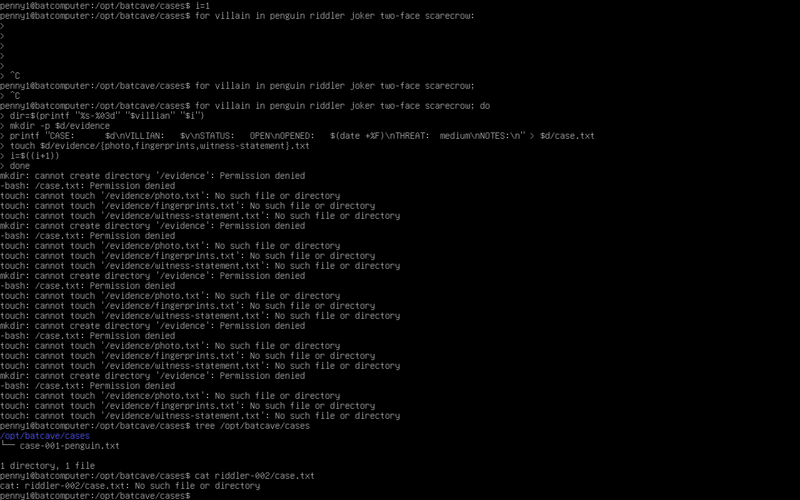
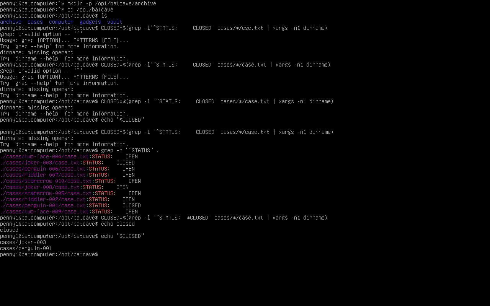

# Lesson 4: Case Files (File Management, Log Analysis, and Backups)

Part of the [Batcomputer Linux Lab](../README.md) | Previous: [Lesson 3](lesson-03-bat-family-roster.md)

This lesson was about handling files the way a sysadmin does: build a structure, search it, investigate a log, back it up, and protect it. I built a case-file system for the Batcomputer, generated a fake access log to investigate, wrote a threat-report script, and practiced archiving and locking down evidence.

## Environment
- **Host:** Ubuntu PC running VMware Workstation
- **Guest:** Ubuntu Server VM (`batcomputer`), admin account `penny1`
- **Client:** SSH from my MacBook and from the host PC

## What I Built

### Case files
One `for` loop created five case folders (`penguin-001` through `scarecrow-005`). Each has a `case.txt` and an `evidence/` folder with three placeholder files. Each `case.txt` is written with a single `printf` that fills in the case ID, villain, status, and date.



I also set up a `.vimrc` ([`config/vimrc`](../config/vimrc)) and changed two cases to `CLOSED` with `sed -i` so I'd have something to archive.

### A log to investigate
[`gen-log.sh`](../scripts/gen-log.sh) writes 200 fake access-log lines (date, time, user, action, IP) to `/var/log/batcave/batcave-access.log`. The data is random, so the results below are chance, not findings. The point is the pipeline:

```bash
grep "LOGIN FAILED" $LOG | awk '{print $3}' | sort | uniq -c | sort -rn
```
`grep` filters, `awk` picks a column, `sort | uniq -c` counts, and `sort -rn` ranks. In my run, `dick` had the most failed logins and `10.0.0.1` was the top source IP.



### A threat report
[`threat-report.sh`](../scripts/threat-report.sh) combines those commands into one report: total events, failed logins, alerts, failed logins by user, the top 5 source IPs, and the five most recent alerts. It accepts an optional log path and defaults to the Batcave log (`LOG=${1:-/var/log/batcave/batcave-access.log}`).



### Backup and restore
I found the closed cases with `grep`, packed them into a compressed `tar.gz` in `archive/`, listed the contents, and extracted the archive into `/tmp/restore-test` to prove it restores.



### Links and protecting evidence
- A **symlink** points at a path. A **hard link** points at the same inode as the original, so the data survives if the original name is deleted.
- `chattr +i` made a file immutable. `rm` failed with "Operation not permitted" even though I own the file. I removed the flag afterward with `chattr -i` so later permission work isn't blocked.




## Issues I Ran Into

### 1. Leftover junk from a Lesson 2 typo
In Lesson 2 I put spaces inside a brace expansion (`{batarang, grapple-gun, ...}`). Bash doesn't expand braces with spaces in them, so it created literal files and folders named things like `cases,`, `gadgets,`, and `vault}` in my home directory. I removed them by quoting the names and using `--`, so the shell treated them literally. Then I rebuilt the real gadget files.




**Takeaway:** No spaces inside braces. Run `ls` before `rm`. Quote names with odd characters.

### 2. Couldn't paste into the VM console, so I typed everything by hand
The VM console wouldn't take pasted text, so I typed the case loop manually. That's where the next two bugs came from. For the rest of the lesson I used SSH, where paste works.

### 3. Empty variables turned paths into `/evidence`
I mixed up variable names: I set one name and used another, so the variables were empty. The paths became `/evidence` and `/case.txt`, and bash refused with `Permission denied`. The system's permissions stopped it from writing in the wrong place.



**Fix:** Use the same names throughout (`v` for the villain, `d` for the directory).

### 4. A typo that ran without any error
My second attempt created everything, but the villain line read `VILLAIN:    $`. I typed `$` and left out the variable name. Bash treats a lone `$` as a literal dollar sign, so it didn't complain. I only caught it by reading the output.


**Takeaway:** No errors doesn't mean correct. Check the output with `cat` or `grep`.

### 5. `dirname: missing operand`
My archive command looked for closed cases using an exact number of spaces after `STATUS:`. My files had different spacing, so `grep` found nothing, and `xargs` ran `dirname` with no input. I confirmed the cases were actually closed, then changed the pattern.



**Fix:** `grep -l '^STATUS: *CLOSED'` matches any amount of spacing, and `xargs -r` skips the command when there's no input.

### 6. Re-running the loop doubled my cases
After fixing the typo I re-ran the loop without resetting the counter, so I ended up with ten cases (`006` through `010` duplicated the first five, with the counter continuing). I deleted the extras and fixed the villain lines in the originals:

```bash
rm -rf penguin-006 riddler-007 joker-008 two-face-009 scarecrow-010
for d in penguin-001 riddler-002 joker-003 two-face-004 scarecrow-005; do
  v=${d%-*}
  sed -i "s/^VILLAIN:.*/VILLAIN:   $v/" $d/case.txt
done
```

**Takeaway:** A loop isn't safe to re-run unless it resets its state. Set `i=1` at the top and check the result afterward.

## Key Takeaways
- Read the error. `missing operand` and `Permission denied` on `/evidence` both pointed at an empty variable.
- Verify output, not just exit status. A silent typo is harder to catch than a loud failure.
- Quote paths and variables that might contain odd characters.
- Match patterns loosely (` *`) when whitespace might vary.
- A backup isn't real until I've restored it.
- Remove protection flags (`chattr -i`) before moving on.
- Hand-typing long commands invites typos. Use SSH so I can paste, and save repeated work in scripts.

## Skills Demonstrated
- File management: `find`, `grep`, `cat`, `head`, `tail`, `wc`
- Text pipelines with `grep`, `awk`, `sort`, `uniq`, `sed`
- Bash scripting: loops, `printf`, variable defaults, `xargs -r`
- Archiving and restoring with `tar`
- Hard links, symlinks, and inodes
- File attributes with `chattr` and `lsattr`
- Debugging from error messages

## Checklist
- [x] Built five case folders with evidence
- [x] Wrote and ran `gen-log.sh` and `threat-report.sh`
- [x] Closed two cases and archived them
- [x] Restored the archive and checked its contents
- [x] Explained symlink vs. hard link
- [x] Made a file immutable, then removed the flag

[← Lesson 3](lesson-03-bat-family-roster.md) | [Lesson 5 →](lesson-05-clearance-levels.md)
