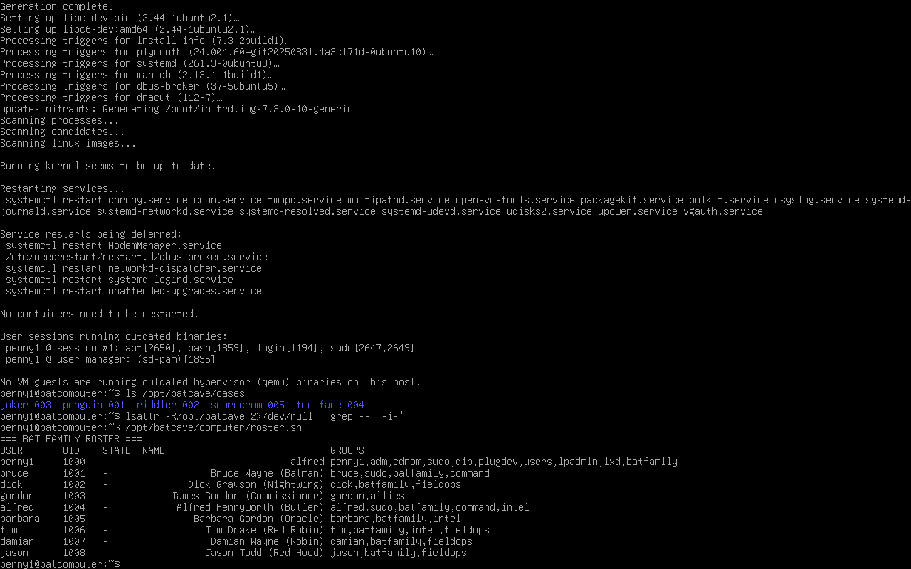
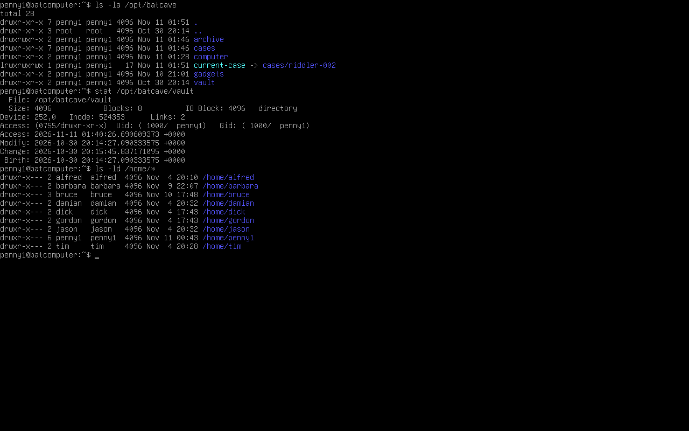
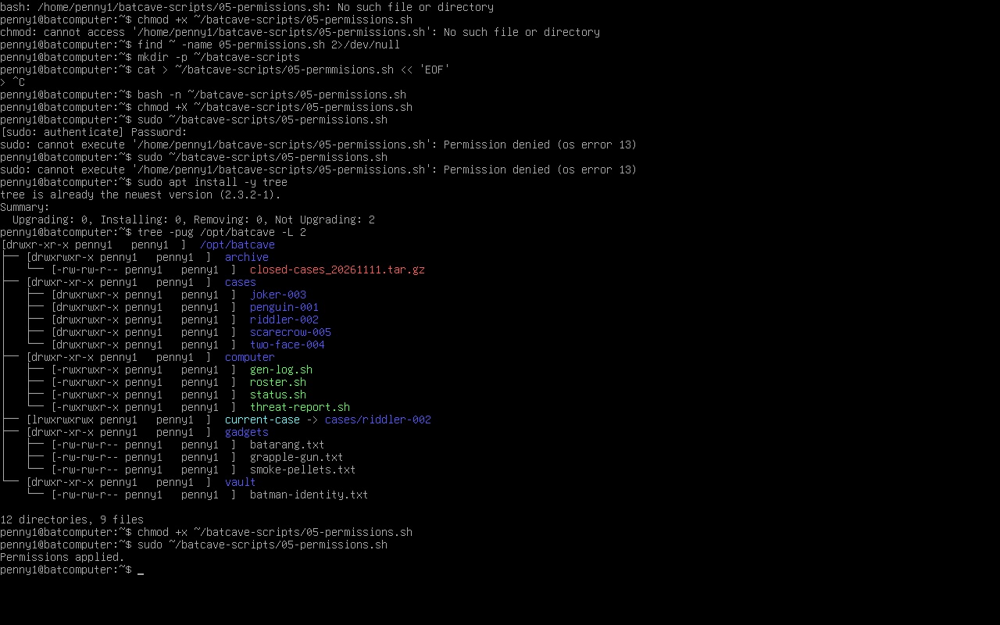
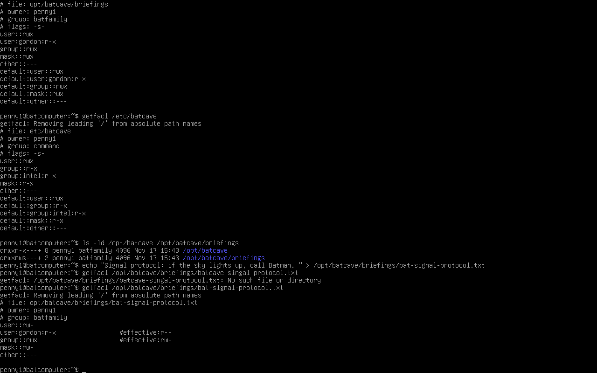
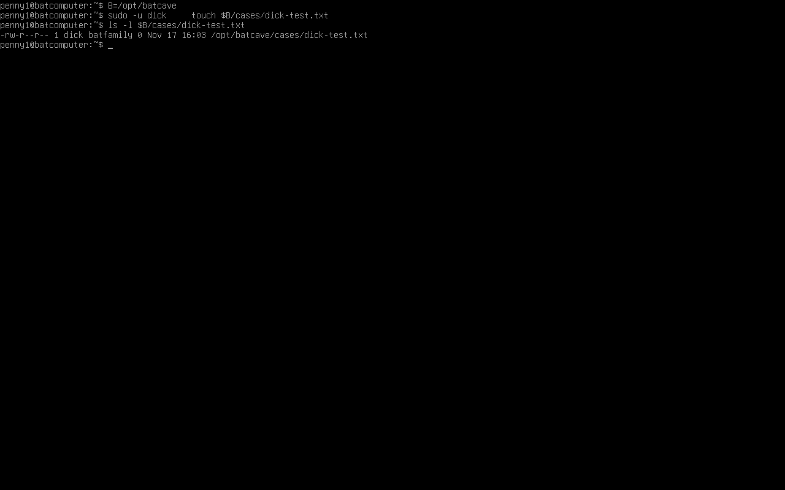
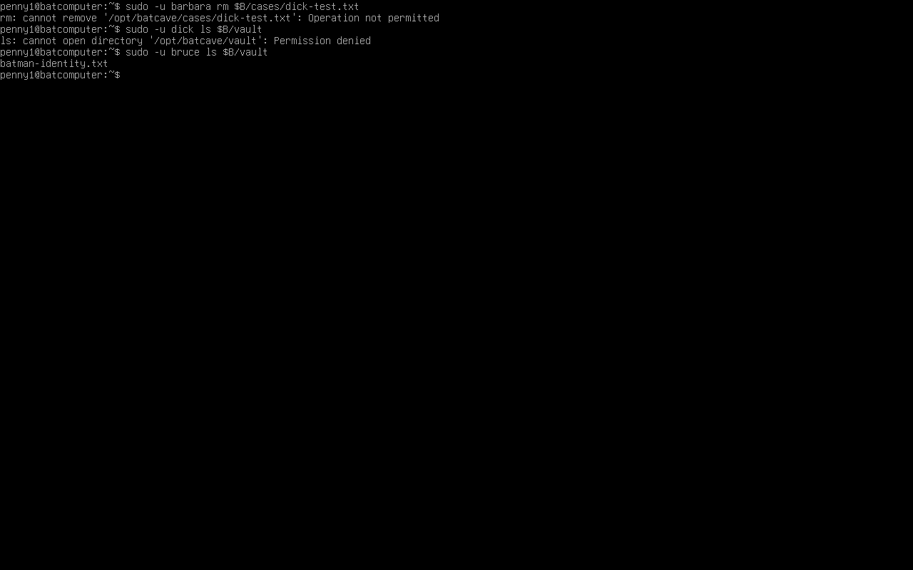
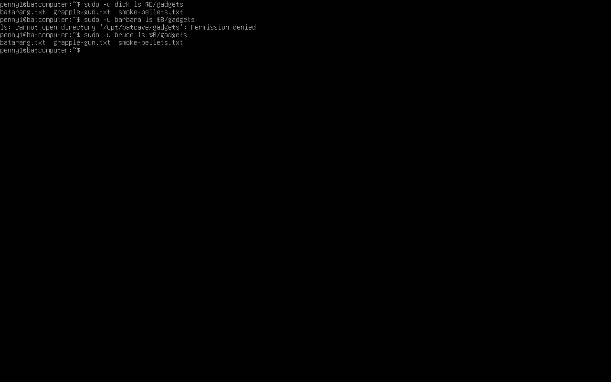
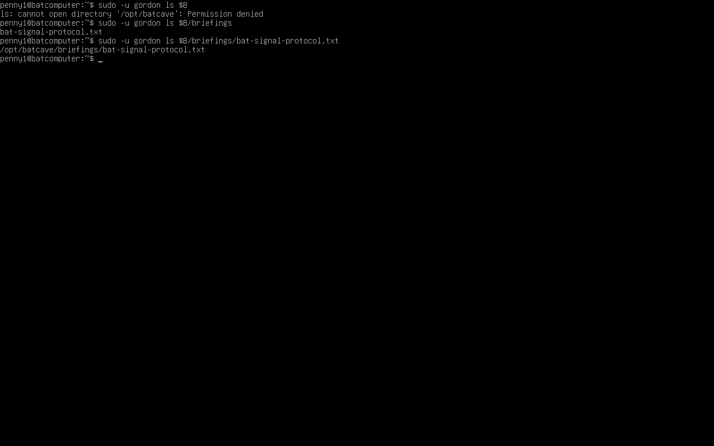
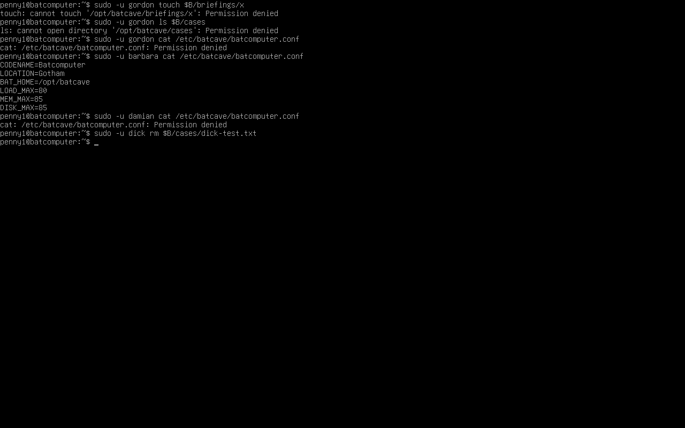

# Lesson 5: Clearance Levels (File Permissions and ACLs)

Part of the [Batcomputer Linux Lab](../README.md) | Previous: [Lesson 4](lesson-04-case-files.md)

This lesson was about controlling who can reach what. Until now `penny1` owned everything in the Batcave, so anyone who got in could touch anything. I wrote a clearance matrix, applied it with one script, added ACLs for the exceptions that normal permissions can't express, and then tested it by running commands as different Bat Family members.

## Environment
- **Host:** Ubuntu PC running VMware Workstation
- **Guest:** Ubuntu Server VM (`batcomputer`), admin account `penny1`
- **Client:** SSH from my MacBook and from the host PC

## The Clearance Matrix

| Path | Owner:Group | Mode | Who gets in |
|---|---|---|---|
| `/opt/batcave` | penny1:batfamily | 750 | batfamily (gordon passes through via ACL) |
| `computer/` | penny1:batfamily | 750 | batfamily can run the scripts |
| `/etc/batcave` | penny1:command | 2750 | command reads; `intel` reads via ACL |
| `cases/` | penny1:batfamily | 3770 | batfamily read/write, with SGID + sticky bit |
| `gadgets/` | penny1:fieldops | 2770 | fieldops; `command` via ACL |
| `vault/` | penny1:command | 2770 | command only |
| `archive/` | penny1:command | 2770 | command only |
| `/var/log/batcave` | batsvc:batfamily | 2750 | batsvc writes, batfamily reads |
| `briefings/` | penny1:batfamily | 2770 | batfamily read/write; gordon read-only via ACL |

Reading the modes: `r=4 w=2 x=1`, one digit each for owner, group, and everyone else. A fourth leading digit adds special bits: `1` is the sticky bit, `2` is SGID, and `4` is SUID. So `3770` is sticky + SGID + `rwxrwx---`.
- **SGID on a directory:** new files inherit the directory's group instead of the creator's group.
- **Sticky bit:** in a shared directory, only a file's owner can delete it (this is how `/tmp` works).

## What I Built

### Starting point
Before changing anything, I made sure the lab was in the state Lesson 4 left it. The five case folders were there, and the `lsattr` check for leftover immutable files printed nothing. I also pulled up the roster, because the tests depend on who is in which group.



| User | Relevant groups |
|---|---|
| bruce | batfamily, command |
| alfred | batfamily, command, intel |
| barbara | batfamily, intel |
| tim | batfamily, intel, fieldops |
| dick, damian, jason | batfamily, fieldops |
| gordon | allies (not batfamily) |

Here is how the Batcave looked before the lock-down: everything owned by `penny1`, with directories at `755` so anyone could look around.



### Applying the matrix with a script
[`05-permissions.sh`](../scripts/05-permissions.sh) applies every row of the matrix with `chown` and `chmod`. It checks that it's running as root, uses `set -e` so it stops at the first failure, and is safe to re-run. The key lines:

```bash
chown penny1:batfamily $BASE     # set who owns it
chmod 750 $BASE                  # set what the owner, group, and everyone else can do
chmod 3770 $BASE/cases           # sticky + SGID + rwxrwx---
chmod 2770 $BASE/vault           # SGID + rwxrwx---
```

The screenshot below shows the `tree -pug` view from before the script ran, with every folder still `penny1:penny1`, followed by the script finishing with `Permissions applied.` The errors above it are from my first attempts (see Issues).



### ACLs for the exceptions
Normal owner/group/other permissions can't say "Gordon may read briefings but nothing else" or "intel may read the config." Gordon is only in `allies`, so he has no group access at all. ACLs handle these cases:

```bash
sudo setfacl -m u:gordon:x /opt/batcave                    # pass through only
sudo setfacl -m u:gordon:rx /opt/batcave/briefings         # read-only
sudo setfacl -d -m u:gordon:rx /opt/batcave/briefings      # default: new files inherit it
sudo setfacl -R -m g:intel:rX /etc/batcave                 # intel can read config
sudo setfacl -d -m g:intel:rX /etc/batcave
sudo setfacl -m g:command:rx /opt/batcave/gadgets          # command can read gadgets
```

`getfacl` shows the extra entries, and a `+` at the end of the `ls -ld` permissions means an ACL is present. I created a briefing file after setting the default ACL to confirm it inherited gordon's entry.



### Testing the matrix
I ran 16 commands as different users with `sudo -u <user>` and compared each result with what the matrix says should happen.

| # | Command | Expected | Result |
|---|---|---|---|
| 1 | `dick` creates a file in `cases/` | Works (group should be batfamily) | ✅ Works, group is `batfamily` |
| 2 | `barbara` deletes dick's file | Denied (sticky bit) | ✅ `Operation not permitted` |
| 3 | `dick` lists `vault/` | Denied (not in command) | ✅ `Permission denied` |
| 4 | `bruce` lists `vault/` | Works (command) | ✅ Shows `batman-identity.txt` |
| 5 | `dick` lists `gadgets/` | Works (fieldops) | ✅ Works |
| 6 | `barbara` lists `gadgets/` | Denied | ✅ `Permission denied` |
| 7 | `bruce` lists `gadgets/` | Works (command via ACL) | ✅ Works |
| 8 | `gordon` lists `/opt/batcave` | Denied (can pass through, can't list) | ✅ `Permission denied` |
| 9 | `gordon` lists `briefings/` | Works (ACL) | ✅ Works |
| 10 | `gordon` lists the briefing file | Works (ACL) | ✅ Works |
| 11 | `gordon` creates a file in `briefings/` | Denied (read-only) | ✅ `Permission denied` |
| 12 | `gordon` lists `cases/` | Denied | ✅ `Permission denied` |
| 13 | `gordon` reads the config file | Denied | ✅ `Permission denied` |
| 14 | `barbara` reads the config file | Works (intel via ACL) | ✅ Prints the config |
| 15 | `damian` reads the config file | Denied | ✅ `Permission denied` |
| 16 | `dick` deletes his own file | Works (owner) | ✅ No error |







Every result matched the matrix. The denials are the useful part, since they show the lock-down is doing its job.

## Issues I Ran Into

### 1. The script wasn't where I thought it was
My first attempt to create the script used the wrong path (`_/batcave-scripts/...` instead of `~/batcave-scripts/...`), so the file never landed in the folder I expected and the next commands failed with `No such file or directory`. I also misspelled the filename once while retyping. `find ~ -name 05-permissions.sh` came back empty, which told me the file didn't exist yet. I created the folder with `mkdir -p ~/batcave-scripts` and wrote the script again.

**Takeaway:** `~` means my home folder. Without it, a path is relative to wherever I currently am. When a file "isn't there," `find` is faster than guessing.

### 2. `Permission denied (os error 13)` on a script I own
Once the script existed, `sudo ~/batcave-scripts/05-permissions.sh` failed with `cannot execute ... Permission denied`. I had run `chmod +X` with a **capital X**. Capital `X` only adds execute permission to directories, or to files that are already executable by someone, so on a brand-new script it did nothing. Lowercase `chmod +x` fixed it, and the script ran and printed `Permissions applied.`


**Takeaway:** `bash -n` only checks syntax, not whether the file can run. Check with `ls -l` for an `x`.

## What I Noticed

### The sticky bit and `chattr +i` give the same error message
When `barbara` tried to delete `dick`'s file, the error was `Operation not permitted`. That's the same message I got in Lesson 4 when `rm` hit an immutable file. A plain `Permission denied` appeared when a user had no access to a directory at all (like `dick` in the vault). The wording is a clue: "Permission denied" means the access bits blocked me, while "Operation not permitted" means something else is stopping the action even though I might otherwise have write access.

### The ACL mask limited gordon's access
The new briefing file showed this:
```
user:gordon:r-x     #effective:r--
group::rwx          #effective:rw-
mask::rw-
```
Gordon's ACL entry says `r-x`, but the file's **mask** is `rw-`, because new files aren't created executable. The mask caps what any ACL entry can do, so gordon ends up with read-only, which is what I wanted. If an ACL ever seems to be ignored, the `mask::` line is the first thing to check.

### Dick's new file had the right group but wasn't group-writable
The file `dick` created in `cases/` came out as `-rw-r--r-- dick batfamily`. SGID worked, since the group is `batfamily` and not dick's own group. But the mode `644` means the rest of the family can read the file and can't edit it. I believe this is because `sudo -u` applies its own default umask (`022`) instead of the login umask. It's a reminder that a directory's SGID bit controls the group, while the **umask** controls the permission bits on new files.

## Key Takeaways
- `chown` sets who owns something, and `chmod` sets what each category can do. They work as a pair.
- SGID on a directory keeps new files in the right group, and the sticky bit stops people from deleting each other's files.
- ACLs handle the exceptions that owner/group/other can't, but the mask can quietly limit them.
- Test the lock-down, not just the setup. The denials prove the policy works.
- Read the exact error wording. `Permission denied` and `Operation not permitted` mean different things.
- Check that a script is executable (`ls -l`), not just that its syntax is valid.

## Skills Demonstrated
- File ownership and permissions: `chown`, `chgrp`, `chmod` (octal and symbolic)
- Special permission bits: SGID and the sticky bit
- POSIX ACLs: `setfacl`, `getfacl`, default ACLs, and the mask
- Enforcing least privilege across users and groups
- Testing access controls with `sudo -u`
- Scripting a permission policy that's safe to re-run
- Debugging from error messages

## Checklist
- [x] Confirmed no leftover immutable files and checked group memberships before starting
- [x] Wrote and ran `05-permissions.sh`, and confirmed `Permissions applied.`
- [x] Added ACLs for gordon, intel, and command
- [x] Ran 16 tests as different users, and all matched the matrix
- [x] Explained SGID, the sticky bit, and how an ACL differs from a mode
- [ ] Ran the system-wide permission audit (still to do)

[← Lesson 4](lesson-04-case-files.md)
